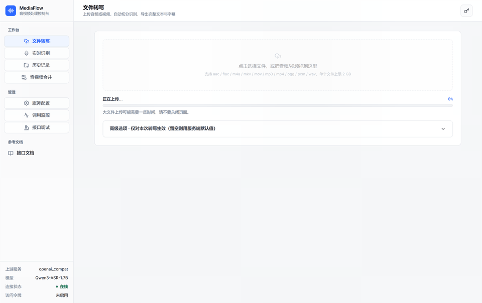
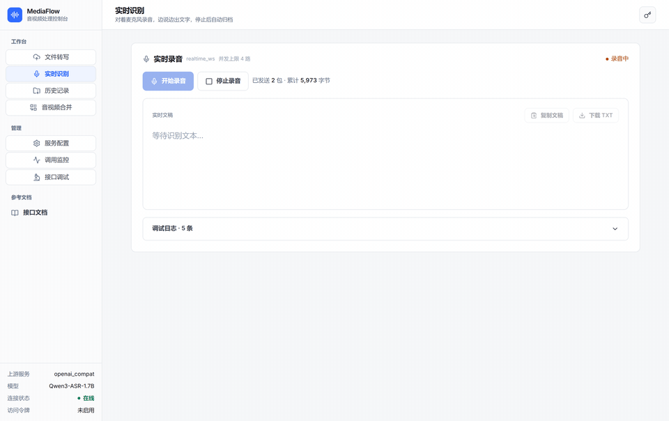
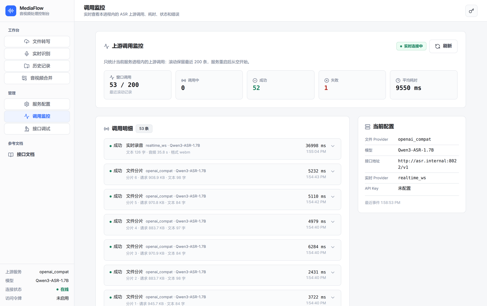
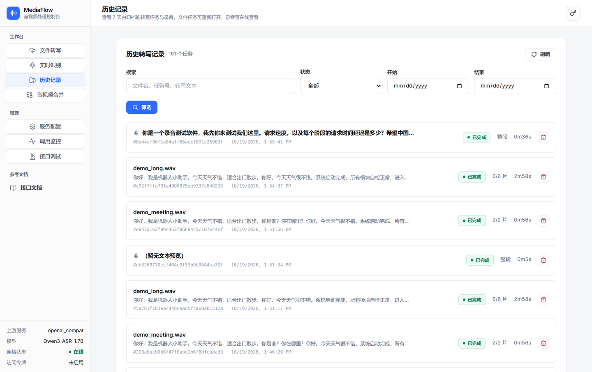
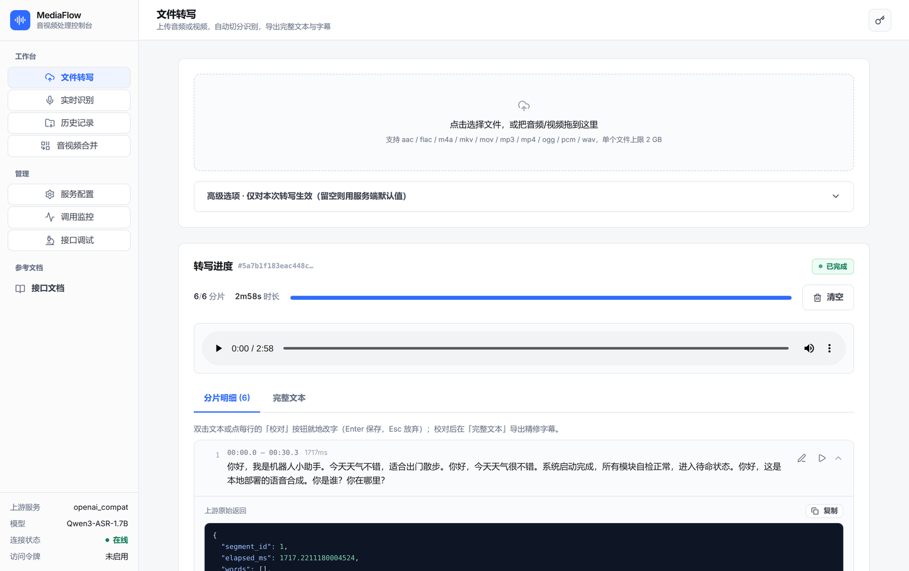

# MediaFlow

[](https://github.com/StanlySGY/MediaFlow/actions/workflows/ci.yml)
[](https://github.com/StanlySGY/MediaFlow/releases)
[](LICENSE)

**[中文](README.md) · English**

| File transcription: upload → segment progress → double-click proofread → subtitle export | Realtime: partial grows live → final |
| --- | --- |
|  |  |

| Service config / upstream probe | Task history | Raw upstream response for one segment |
| --- | --- | --- |
|  |  |  |

> ASR endpoints in the screenshots were rewritten to `asr.internal`; no real intranet IP is included. Mobile layout: [`docs/screenshots/mobile.png`](docs/screenshots/mobile.png).

An audio/video toolbox built on FastAPI / asyncio / FFmpeg that combines three capabilities: long-audio splitting, streaming ASR transcription against an OpenAI-compatible endpoint, and lossless media concatenation. **MediaFlow ships no ASR model** — recognition is done by an upstream service you already run. Read the capability boundary table first.

- Multi-format input (mp3/wav/m4a/flac/aac/ogg/pcm/mp4/mov/mkv), normalized to 16k mono `pcm_s16le` by FFmpeg
- Three split strategies: `fixed` / `silence` (silence-aware) / `overlap`
- Concurrent per-segment ASR calls under an asyncio semaphore, with exponential-backoff retries and per-segment failure isolation
- Server-sent events push every segment result (multi-subscriber + replay buffer, so a page refresh loses nothing)
- Timeline-aware stitching: with word timestamps the overlap is cropped at the midpoint; otherwise longest-common-substring dedup
- SRT / VTT subtitle export
- Pluggable ASR provider registry (`openai_compat`, `openai_chat_audio`, plus realtime providers)
- Optional Bearer-token auth; the browser gets a short-lived HttpOnly cookie for `EventSource`
- Task results persist to `outputs/`, so `/result` still works after a restart
- Built-in React console: file tasks / realtime / service config / history — drag-and-drop upload with real progress, live segment progress, playback-linked proofreading, double-click segment editing with client-side refined subtitle export, in-place editable runtime config, upstream connectivity test, per-segment raw response, responsive mobile drawer layout
- **Lossless concat** (`POST /media/concat`: ≥2 same-format files joined in upload order via the concat demuxer with `-c copy`, no re-encode, output format = input format, audio and video)
- **Realtime pipeline** (`POST /asr/realtime/session` → base64 audio chunks → SSE events → `POST end`)

## Capability boundary

| Capability | In this project | Notes |
| --- | --- | --- |
| ASR model / weights | ❌ **none bundled** | MediaFlow only makes HTTP requests. Transcription quality = your upstream model's quality. You must supply DashScope / vLLM / FunASR / your own faster-whisper gateway |
| Long-audio splitting | ✅ | `fixed` / `silence` / `overlap`, pure FFmpeg |
| Stitching segment results | ✅ | Word timestamps → crop at overlap midpoint; otherwise LCS dedup |
| Word-level timestamps | ⚠️ upstream-dependent | Only real when the upstream actually returns `words[]` |
| Subtitle granularity | ⚠️ degrades with upstream | Non-empty `words` → re-segmented by length/duration/pause; empty `words` → **one subtitle per split segment** |
| Speaker diarization | ❌ **upstream's job** | No diarization model, no voiceprint clustering. If the upstream emits no speaker label, you get none |
| Punctuation / translation / speaker naming | ❌ | Requires upstream capability or post-processing |
| Realtime endpointing | ⚠️ provider-dependent | `realtime_ws` / `realtime_http` defer to the upstream realtime service; `realtime_offline` records then transcribes the whole take — not streaming |
| Horizontal scaling | ❌ single process | Task state, SSE subscriptions and realtime sessions live in process memory. Never add `--workers` |

Where upstream speaker labels end up, per provider:

| Provider | Fate of upstream `speaker` labels |
| --- | --- |
| `openai_compat` | **not parsed.** Only top-level `text` and `words[]` are read. `verbose_json.segments[].speaker` survives in the raw response at `/asr/task/{id}/segments/{id}/raw`, but never reaches the subtitles |
| `openai_chat_audio` | Parses `segments[].speaker` / `speaker_id` and `[SPEAKER_00]`-style labels in the text into `words[].speaker`; subtitles break on speaker change and carry `[speaker]` |
| `realtime_offline` | Groups the transcript by speaker after full-audio transcription |

To actually get diarization, enable it **on the upstream side**: OpenAI `response_format=diarized_json` with `model=gpt-4o-transcribe-diarize`; self-hosted faster-whisper gateways with `WHISPER_DIARIZATION=1`; FunASR `moss-transcribe-diarize`. On the MediaFlow side you only change `ASR_MODEL`.

## Quick start

### Local

```bash
cp .env.example .env         # fill in ASR_API_KEY
pip install -r requirements.txt
uvicorn app.main:app --host 127.0.0.1 --port 8080
```

`ffmpeg` and `ffprobe` must be installed. UI at `http://localhost:8080/`, OpenAPI at `/docs`.

Runtime configuration can be edited from the UI's service-config panel (provider, base URL, API key, model, hotwords, split parameters, access tokens) and takes effect without a restart. Changes persist to `config/runtime_config.json`, which may contain API keys and tokens — the service tightens it to `0600` after writing; do not commit it or expose it to other users.

### Docker

```bash
cp .env.example .env
docker compose up -d --build
```

Only loopback is published by default (port from `.env`'s `PORT`, default 8080). To reach the service from another machine, set a strong random `ACCESS_TOKENS` (`openssl rand -hex 32`) **first**, then publish `"8080:8080"` or switch `HOST` to `0.0.0.0`, plus firewall/security-group rules. Never expose the service without tokens.

### Air-gapped delivery

```bash
./build.sh --save                                  # build machine: mediaflow-1.7.3-arm64.tar.gz
docker load -i mediaflow-1.7.3-arm64.tar.gz        # target host
cp .env.example .env
docker compose -f docker-compose.prod.yml up -d    # prod compose has no `build:` on purpose
```

`docker-compose.prod.yml` pins `mediaflow:1.7.3` and mounts `./outputs`, `./temp`, `./config` as volumes, so re-loading an image keeps history and saved configs. Full field manual: [DEPLOY_ONSITE.md](DEPLOY_ONSITE.md).

## Wiring an upstream ASR you already run

| `ASR_PROVIDER` | Upstream endpoint | Works with | Word timestamps | Upstream speaker labels |
|---|---|---|---|---|
| `openai_compat` | `POST /v1/audio/transcriptions` (multipart) | OpenAI's own API, self-hosted faster-whisper OpenAI gateways (e.g. scribecrate), DashScope compat transcriptions, FunASR `funasr-server` | ✅ if the upstream honours `timestamp_granularities[]` | ❌ reads `text` / `words` only; `segments[].speaker` stays in the raw response |
| `openai_chat_audio` | `POST /v1/chat/completions` (JSON + base64 `input_audio`) | vLLM Qwen3-ASR-Flash, DashScope compat chat multimodal, any deployment that serves an audio model as a multimodal LLM | ⚠️ only if the upstream also returns `segments[]` | ✅ parses `segments[].speaker` and `[SPEAKER_00]` labels |

Discriminate with one curl:

```bash
# 200/OK → openai_compat
curl -X POST $ASR_BASE_URL/audio/transcriptions \
  -F "file=@any.wav" -F "model=$ASR_MODEL" -H "Authorization: Bearer $ASR_API_KEY"

# 200/OK → openai_chat_audio
DATA_URI="data:audio/wav;base64,$(base64 -w0 any.wav)"
curl -X POST $ASR_BASE_URL/chat/completions \
  -H "Content-Type: application/json" -H "Authorization: Bearer $ASR_API_KEY" \
  -d '{"model":"'$ASR_MODEL'","messages":[{"role":"user","content":[{"type":"input_audio","input_audio":{"data":"'$DATA_URI'"}}]}]}'
```

Or open the service-config panel and press **Test connection** — the server probes the current provider with a 1s silent WAV and shows 200/4xx inline.

> A service named `faster-whisper-server` is **not necessarily** OpenAI-compatible: the widely copied `ayutaz/faster-whisper-server` exposes only `GET/POST /transcribe`, so `ASR_PROVIDER=openai_compat` will 404. Add a shim, or write a custom provider.

### Three upstreams, four lines of `.env` each

**A. Self-hosted faster-whisper OpenAI gateway** (the OpenAI API itself works the same way)

```bash
ASR_PROVIDER=openai_compat
ASR_BASE_URL=http://127.0.0.1:8000/v1
ASR_MODEL=whisper-large-v3
ASR_TIMESTAMPS=true
```

Verify timestamps instead of guessing:

```bash
curl -sX POST $ASR_BASE_URL/audio/transcriptions \
  -F "file=@any.wav" -F "model=$ASR_MODEL" \
  -F "response_format=verbose_json" -F "timestamp_granularities[]=word" | head -c 400
```

Top-level `"words":[{...}]` → keep `ASR_TIMESTAMPS=true`. A 400 on `timestamp_granularities[]`, or empty `words` → set `ASR_TIMESTAMPS=false`. Enable diarization upstream (`WHISPER_DIARIZATION=1`); `openai_compat` does not surface it.

**B. FunASR (SenseVoice / Paraformer)**

```bash
# upstream: funasr-server --host 0.0.0.0 --port 8000 --model sensevoice --device cuda:0
ASR_PROVIDER=openai_compat
ASR_BASE_URL=http://127.0.0.1:8000/v1
ASR_MODEL=sensevoice
ASR_TIMESTAMPS=false     # this gateway's multipart accepts only file/model/language/response_format
```

`ASR_TIMESTAMPS=false` is the correct setting here, not a compromise: the field does not exist, and leaving it on only risks a failed request. Subtitles degrade to one entry per segment. For speakers, switch the upstream to `funasr-server --model moss-transcribe-diarize` with `response_format=verbose_json`.

**C. vLLM serving Qwen3-ASR**

```bash
# upstream: vllm serve /models/Qwen3-ASR-Flash --served-model-name qwen3-asr --port 8000
ASR_PROVIDER=openai_chat_audio
ASR_BASE_URL=http://127.0.0.1:8000/v1
ASR_MODEL=qwen3-asr      # must match --served-model-name
ASR_TIMESTAMPS=false
```

`vllm serve`'s audio entry point accepts complete audio and returns a complete result — it does not stream. For the realtime page either use `realtime_offline` (record, then transcribe the whole take) or point at a realtime ASR upstream.

### 30-second acceptance check

```bash
curl -sX POST http://localhost:8080/asr/ping
curl -sX POST http://localhost:8080/asr/file -F "file=@any.wav"
curl -N http://localhost:8080/asr/file/<task_id>/events
curl -s  http://localhost:8080/asr/file/<task_id>/result | head -c 600
```

Non-empty `result.segments[].words` → timeline-aware stitching + fine-grained subtitles. Empty → LCS dedup + one subtitle per segment. **That is intended behaviour, not a bug** — unless your upstream was supposed to return word timestamps.

Upstream protocol facts were verified against sources in Oct 2026: OpenAI API reference (`response_format`, `timestamp_granularities[]`, `verbose_json.words[]`); `hwdsl2/scribecrate` README (`WHISPER_DIARIZATION`, `timestamp_granularities[]` defaulting to `["segment"]`, OpenAI-only diarize options returning 400); `modelscope/FunASR` `examples/openai_api/OPENAPI.md` (multipart field table, `moss-transcribe-diarize`); `ayutaz/faster-whisper-server` README (`/transcribe` only).

## Realtime

```text
POST   /asr/realtime/session            create session → returns events/audio/end URLs
POST   /asr/realtime/{id}/audio         { seq, audio: base64, is_final }
GET    /asr/realtime/{id}/events        SSE: event=online|final|error|done
POST   /asr/realtime/{id}/end           end session
```

`REALTIME_ASR_PROVIDER` ∈ `realtime_mock` / `realtime_http` / `realtime_ws` / `realtime_offline`. Browsers should emit continuous WebM/Opus chunks with a single `MediaRecorder` and upload them serially by `seq`; MediaFlow keeps one FFmpeg per session converting WebM to 16 kHz 16-bit mono PCM. Non-standard WebSocket protocols need their own provider, or a shim into the HTTP+SSE shape above.

```bash
SID=$(curl -sX POST http://localhost:8080/asr/realtime/session \
  -H "Content-Type: application/json" \
  -d '{"sample_rate":16000,"format":"pcm_s16le","channels":1,"language":"zh"}' \
  | python -c "import json,sys; print(json.load(sys.stdin)['session_id'])")
curl -N http://localhost:8080/asr/realtime/$SID/events          # another terminal
curl -X POST http://localhost:8080/asr/realtime/$SID/audio \
  -H "Content-Type: application/json" -d '{"seq":1,"audio":"AAAAAAAA","is_final":false}'
curl -X POST http://localhost:8080/asr/realtime/$SID/end
```

## API

| Method | Path | Purpose |
| --- | --- | --- |
| GET | `/` | Web UI |
| GET | `/auth/info` | Whether auth is enabled |
| GET / POST | `/asr/config` | Current effective config (no plaintext secrets, only `*_set` / `*_count`) / update whitelisted fields, no restart |
| POST | `/asr/config/reset` | Revert runtime changes to `.env` defaults |
| POST | `/asr/ping` | Probe the upstream with a 1s silent WAV |
| POST | `/asr/file` | **Standard file ASR entry**: multipart upload → `task_id` plus `status_url` / `events_url` / `result_url`. Per-task overrides: `model`, `language`, `split_strategy`, `chunk_seconds`, `overlap_seconds`, `hotwords`, `prompt_hints`, `timestamps` |
| GET | `/asr/file/{task_id}` | Status and progress |
| GET | `/asr/file/{task_id}/events` | SSE per-segment events (with `elapsed_ms`) |
| GET | `/asr/file/{task_id}/result` | Final JSON: segments, word timestamps, per-segment timing, upstream raw |
| GET | `/asr/file/{task_id}/subtitle?format=srt\|vtt` | Subtitle download |
| GET | `/asr/task/{task_id}/segments/{segment_id}/raw` | Raw ASR response for one segment (debug only; **`/task` spelling only**) |
| GET | `/asr/tasks` | History: `q`, `status`, `since`, `until`, `offset`, `limit` |
| POST | `/asr/task/{task_id}/cancel` | Cancel an unfinished task (**`/task` spelling only**) |
| DELETE | `/asr/task/{task_id}` | Delete a finished task; 409 while running (**`/task` spelling only**) |
| GET | `/metrics` | Prometheus text metrics |
| POST/GET/DELETE | `/asr/realtime/*` | Session create / list / state / audio / events / end / delete |
| POST | `/media/concat` | ≥2 same-format files, lossless `-c copy` join in upload order; mixed format or a single file → 400 |
| GET | `/health` | Health check |

`/asr/task` (and its `{id}`, `/stream`, `/result`, `/subtitle` twins) are deprecated aliases of `/asr/file` that omit the `*_url` fields; new callers should use `/asr/file`.

With `ACCESS_TOKENS` set, `/asr/*`, `/media/*` and `/metrics` require `Authorization: Bearer <token>`. Successful requests issue a short-lived HttpOnly cookie so `EventSource` connects without a token in the URL. CLI clients still accept `?token=<token>`, but query strings may land in access logs. `/`, `/auth/info` and `/health` are unaffected.

## Configuration

See `.env.example`. Key variables:

| Variable | Meaning | Default |
| --- | --- | --- |
| `ASR_PROVIDER` | ASR backend | `openai_compat` |
| `ASR_BASE_URL` | OpenAI-compatible root path | DashScope compatible-mode |
| `ASR_API_KEY` | API key | *(required)* |
| `ASR_MODEL` | Model name | `qwen3-asr-flash` |
| `ASR_TIMESTAMPS` | Request word timestamps (stitching + subtitles) | `true` |
| `ASR_HOTWORDS` / `ASR_PROMPT_HINTS` | Appended to OpenAI's `prompt` by `openai_compat`; `openai_chat_audio` does not send them | *(empty = off)* |
| `SPLIT_STRATEGY` | `fixed` / `silence` / `overlap` | `silence` |
| `SPLIT_CHUNK_SECONDS` / `SPLIT_OVERLAP_SECONDS` | Target chunk length / overlap seconds (overlap strategy) | `30` / `2` |
| `ASR_CONCURRENCY` / `ASR_MAX_RETRIES` | Concurrent segments / retries per segment | `4` / `3` |
| `MAX_UPLOAD_BYTES` | Upload cap per request | 2 GiB |
| `TASK_TTL_SECONDS` / `OUTPUT_TTL_SECONDS` | In-memory task state TTL / artifact retention | 3600 / 7 days |
| `REALTIME_ASR_PROVIDER` | `realtime_mock` / `realtime_http` / `realtime_ws` / `realtime_offline` | `realtime_mock` |
| `REALTIME_MAX_SESSIONS` | Concurrent realtime sessions across all clients (429 beyond) | 4 |
| `REALTIME_MAX_CHUNK_BYTES` / `REALTIME_MAX_SESSION_BYTES` / `REALTIME_MAX_SESSION_SECONDS` | Per-chunk / per-session byte and duration caps | 1 MiB / 100 MiB / 3600 |
| `ACCESS_TOKENS` | Comma-separated tokens; must be set before exposing the service | *(empty, loopback-only deployment recommended)* |

Model-list probing only touches endpoints from the running config or a saved config profile — save the profile before probing a new self-hosted address.

## Development

```bash
pytest -q
ruff check app asr-deploy-code
cd frontend && npm ci && npm run test && npm run build
```

To add a non-OpenAI upstream, implement the `ASRProvider` protocol (`__aenter__` / `__aexit__` / `transcribe`) in `app/services/asr/yourprovider.py`, register it with `@register("yourprovider")`, and set `ASR_PROVIDER=yourprovider`. `stream_manager`, `merger` and the routes need no changes.

## Roadmap

- **Land diarization downstream**: `Word.speaker` and the realtime path are already wired; what's missing is feeding `openai_compat`'s `verbose_json.segments[].speaker` into `words[]` so file-task subtitles carry `[speaker]` too
- **Translation / summarization** after the full text is assembled
- **Task queue**: tasks are scheduled with in-process `asyncio.create_task`; Celery / RQ + Redis for horizontal scaling

Changelog: [CHANGELOG.md](CHANGELOG.md).

## License

[MIT](LICENSE) © 2026 shigy
